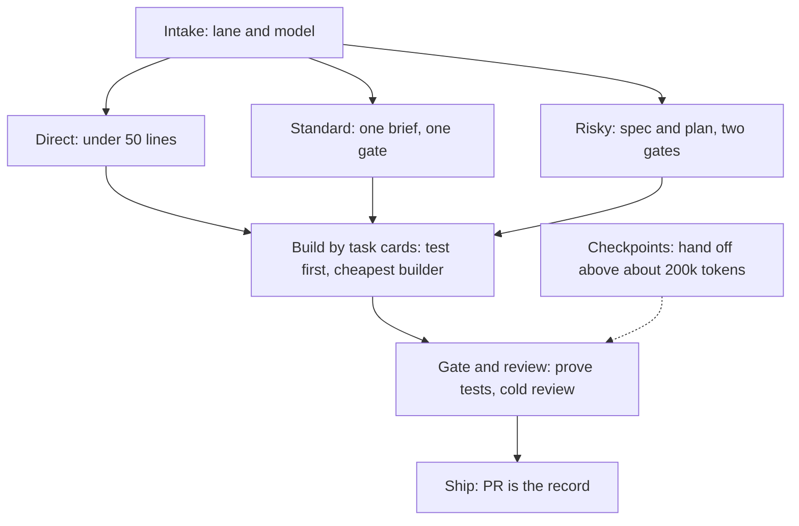
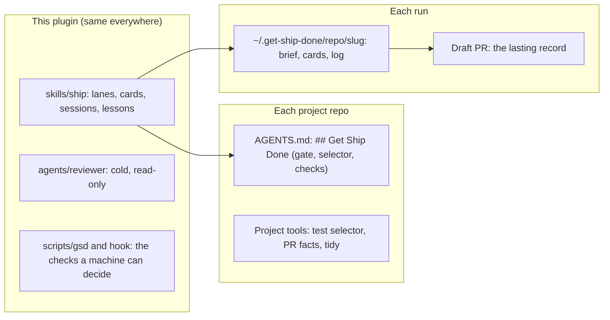

# Get Ship Done by Mubeen

A Claude Code plugin that takes one requirement to a draft pull request. It picks a lane by size and risk (Direct, Standard, Risky), writes one brief or a spec and plan ending in task cards, builds test-first, runs the project's gate, reviews cold where the lane calls for it, and ships. It hands work to fresh sessions at checkpoints so long runs stay cheap.

Overview with diagrams: https://mmubeenejaz.github.io/get-ship-done/

## How a run flows



## Where instructions live



## Install

```
claude plugin marketplace add mmubeenejaz/get-ship-done
claude plugin install get-ship-done@get-ship-done
```

Run it with `/get-ship-done:ship <requirement>`; resume with `/get-ship-done:ship resume <slug>`. Update with `claude plugin marketplace update get-ship-done`.

Requires Node 18 or later and git 2.31 or later on the PATH (the checks and the hook are one script with no dependencies).

## What is enforced, not asked

Rules a machine can decide are checked by `scripts/gsd.mjs`, and every error names its fix. Prose in the skill is kept for judgment.

| Command | Checks |
|---|---|
| `gsd log` | a run log line has its phase's required keys; writes `log.md` and a per-repo `history.log` |
| `gsd lint <brief or plan>` | cards are complete, paths and patterns exist, no pattern is deprecated, every acceptance criterion is covered, no question is open |
| `gsd diff-check --base <ref>` | no skipped, focused or deleted test; no new suppression or workaround comment; no planning file, stray file or Markdown outside the living docs. Other new comments and docs are listed for review |
| `gsd config` | prints the project section as JSON |
| `gsd stats` | card first-pass rate by level and builder, gate first-pass rate, outcomes |

A PreToolUse hook (`hooks/hooks.json`) watches Bash and PowerShell commands. In a session that has run `gsd`, a PR merge, a ready mark or a push to the base branch prompts you for approval, and `--no-verify` is denied. Other sessions are untouched.

## Set up a project

Add a `## Get Ship Done` section to the project's `AGENTS.md` (or `CLAUDE.md`) as `- key: value` lines. The skill and the script read the same lines:

```markdown
## Get Ship Done

- gate: the `ci` workflow on the draft PR
- precheck: `npm run precheck`
- selector: `node scripts/select-tests.mjs`
- tests: `e2e/**`, `**/*.test.ts`
- deprecated: `src/legacy/**`
- docs: `docs/modules/**`, `docs/rules/**`
```

Keys: `gate`, `gate-backup`, `preflight`, `precheck`, `selector`, `migration`, `pr-facts`, `tidy`, `subagent-text`, `tests`, `deprecated`, `docs`, `feature-map`, `verify`. `tests` adds to the built-in test file patterns. `deprecated` lists code no card may copy as its pattern. `docs` lists where a new Markdown file may be added; anywhere else it fails the diff check.

Without the section the skill finds the gate in the CI config and offers to add it.

## Run state

`~/.get-ship-done/<repo>/<slug>/` holds `brief.md` or `spec.md` and `plan.md`, and `log.md`. The draft PR body keeps the criteria and decisions, so the folder is disposable after merge. `~/.get-ship-done/<repo>/history.log` keeps every log line for `gsd stats` and outlives the run folders.

## Changing it

Edit, bump `version` in `.claude-plugin/plugin.json`, push, and update the marketplace on each machine. The gate for this repo is the script's tests, on Windows and on Linux:

```
node --test scripts/gsd.test.mjs
docker run --rm -v "${PWD}:/repo:ro" -w /repo node:18 node --test scripts/gsd.test.mjs
```

A review finding a machine can detect becomes a check here or a lint rule or test in the project; only judgment calls are added to the skill's Lessons. The comment and verification ideas are adapted from Lauren Tan's pstack (cursor/plugins).

## License

MIT
