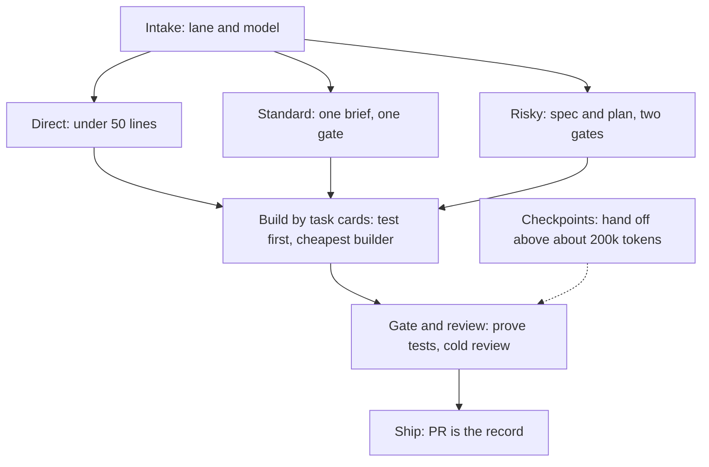
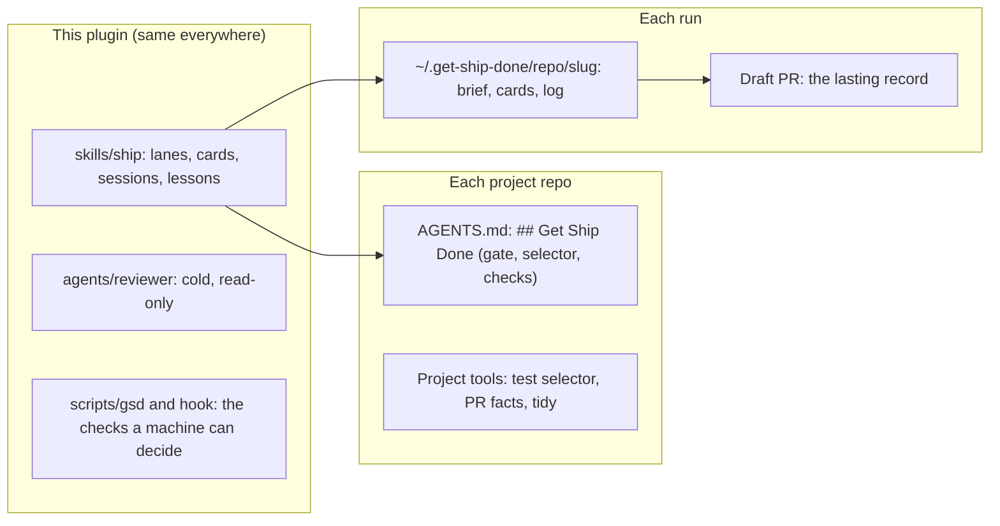

# Get Ship Done by Mubeen

A Claude Code plugin that takes one requirement to a draft pull request. It picks a lane by size and risk (Direct, Standard, Risky), writes one brief or a spec and plan ending in task cards, builds test-first, runs the project's gate, reviews every Standard and Risky change cold, and ships only once `gsd` has verified the ship record itself. It hands work to fresh sessions at checkpoints so long runs stay cheap.

Overview with diagrams: https://mmubeenejaz.github.io/get-ship-done/

## How a run flows



## Where instructions live



## Install

```
claude plugin marketplace add mmubeenejaz/get-ship-done
claude plugin install get-ship-done@get-ship-done
```

Run it with `/get-ship-done:ship <requirement>`; resume with `/get-ship-done:ship resume <slug>`. Update with `claude plugin marketplace update get-ship-done`.

Requires Node 18 or later and git 2.31 or later on the PATH (the checks and the hook are one script with no dependencies).

## What is enforced, not asked

Rules a machine can decide are checked by `scripts/gsd.mjs`, and every error names its fix. Prose in the skill is kept for judgment.

| Command | Checks |
|---|---|
| `gsd log` | a run log line has its phase's required keys; writes `log.md` and a per-repo `history.log`. A `ship` line is refused until gsd's own evidence agrees: the diff check re-run against the intake base with each blocking finding fixed or accepted by the user and each review finding fixed or kept with a reason; the PR open at HEAD; every workflow run on HEAD green and `gate-first-pass` matching the first runs (read through `gh`); and, for Standard and Risky runs, a criterion line per built criterion, one tested criterion proven by breaking the code, and a cold review line; where the guide has `coverage` or `mutate`, each uncovered changed line and surviving mutant fixed or kept; where it has `explore`, a branch that changes UI files has an explore line on HEAD (or on a commit with no UI change since) and each violation fixed or kept |
| `gsd explore --url <url>` | drives the local app in a real browser (Playwright from the project, `--browser msedge` or `chrome` for an installed one) with seeded random clicks, fills and navigation from `--start` routes for `--time` seconds; never touches `[data-explore=skip]`, the guide's `explore-skip` selectors, file inputs, downloads, new tabs or other origins; refuses a host that is not local unless `explore-hosts` lists it. Reports uncaught page errors, console errors, same-origin 5xx and failed requests, blank pages, controls without an accessible name, overflow at phone width, serious axe violations (with `@axe-core/playwright` installed) and the guide's `explore-properties`, with a trace and screenshot each under `--out`; `--replay <trace>` runs it again and `--shrink` cuts it to the actions that still violate; `--slug` logs an `explore` line with HEAD |
| `gsd summary <slug>` | prints the trust record for the PR body: lane, diff-check with kept and accepted findings, cold review, gate first pass, and the criteria with their tests and proof |
| `gsd lint <brief or plan>` | cards are complete, paths and patterns exist, no pattern is deprecated, every acceptance criterion is covered, no question is open |
| `gsd diff-check --base <ref>` | no skipped, focused or deleted test; no new suppression or workaround comment; no planning file, stray file or Markdown outside the living docs; no new import of deprecated code (JS and TS relative, `@/` and `~/` alias, Python modules). Edits inside deprecated code, other new comments and docs, unchanged comments next to changed code, and generic UI tokens on new UI lines, are listed for review |
| `gsd features --base <ref>` | prints the features a branch touches with their routes and specs, from the project's feature map; lists source files no feature claims |
| `gsd ui-audit [path ...]` | lists generic UI tokens (decorative gradients, glass, emoji, one-off values, removed focus rings, hype copy) in tracked screens, with a tally per rule, as the audit before an unslop |
| `gsd deprecated` | lists each deprecated area with its file count and importers; marks one nothing imports `ready-to-delete` and one matching no file `stale-glob`; deletes nothing |
| `gsd coverage --base <ref>` | lists changed source lines with zero hits in the lcov report and changed files missing from it; fails on a report older than HEAD |
| `gsd changed --base <ref>` | prints changed line ranges of source files as `path:start-end`, to scope a mutation run |
| `gsd mutation --base <ref>` | lists mutants that survived, or that no test ran, on changed lines, from a mutation-testing-elements JSON report |
| `gsd config` | prints the project section as JSON |
| `gsd stats` | card first-pass rate by level and builder, gate first-pass rate, outcomes, and escaped bugs per layer (deploy, release, post-release) with the checks they added |

A PreToolUse hook (`hooks/hooks.json`) watches Bash and PowerShell commands. In a session that has run `gsd`, a PR merge, a ready mark or a push to the base branch prompts you for approval, and `--no-verify` is denied. At a checkpoint log line (`ship`, `next`, a `clarify` or `design` done line) it reads the context size from the session transcript, and above 200k tokens tells the orchestrator to hand off to a fresh session with the exact resume brief, logging a `context high` line that `gsd summary` reports until a `handoff` line follows. It never blocks the command for this. Other sessions are untouched.

## Set up a project

Run `/get-ship-done:setup` in the project. It drafts the section below, reports what the project lacks for safe agent work (gate, strict types, lint boundaries, a suppression baseline, rules nothing enforces), and seeds a feature map: one file per user-facing feature with its code paths, its specs and how to drive it in the running app, plus one verification recipe. It asks before writing.

Or write the `## Get Ship Done` section by hand in the project's `AGENTS.md` (or `CLAUDE.md`) as `- key: value` lines. The skill and the script read the same lines:

```markdown
## Get Ship Done

- gate: the `ci` workflow on the draft PR
- precheck: `npm run precheck`
- selector: `node scripts/select-tests.mjs`
- tests: `e2e/**`, `**/*.test.ts`
- deprecated: `src/legacy/**`
- docs: `docs/modules/**`, `docs/rules/**`
```

Keys: `gate`, `gate-backup`, `preflight`, `precheck`, `selector`, `migration`, `pr-facts`, `tidy`, `subagent-text`, `tests`, `deprecated`, `docs`, `feature-map`, `verify`, `design`, `coverage`, `lcov`, `mutate`, `mutation-report`, `explore`, `explore-hosts`, `explore-skip`, `explore-properties`, `explore-state`, `explore-browser`, `smoke`, `health`. `explore` is the local URL `gsd explore` drives by default, and turns on its check at ship; the other `explore-` keys list allowed non-local hosts, selectors it never touches, a module of project properties, a signed-in storage state and an installed browser channel. `tests` adds to the built-in test file patterns. `deprecated` lists code no card may copy as its pattern and no new code may import. `coverage` and `mutate` name the commands whose reports (`lcov`, default `coverage/lcov.info`; `mutation-report`, default `reports/mutation/mutation.json`) ship then checks on changed lines. `smoke` and `health` name what a project's deploy skill runs after a release. `docs` lists where a new Markdown file may be added; anywhere else it fails the diff check.

Without the section the skill finds the gate in the CI config and offers the setup skill.

## Run state

`~/.get-ship-done/<repo>/<slug>/` holds `brief.md` or `spec.md` and `plan.md`, and `log.md`. The draft PR body keeps the criteria, the decisions and the `gsd summary` trust record, so the folder is disposable after merge. `~/.get-ship-done/<repo>/history.log` keeps every log line for `gsd stats` and outlives the run folders.

## Changing it

Edit, bump `version` in `.claude-plugin/plugin.json`, push, and update the marketplace on each machine. The gate for this repo is the script's tests, on Windows and on Linux:

```
node --test scripts/gsd.test.mjs
docker run --rm -v "${PWD}:/repo:ro" -w /repo node:18 node --test scripts/gsd.test.mjs
```

A review finding a machine can detect becomes a check here or a lint rule or test in the project; only judgment calls are added to the skill's Lessons. The comment and verification ideas are adapted from Lauren Tan's pstack (cursor/plugins).

## License

MIT
