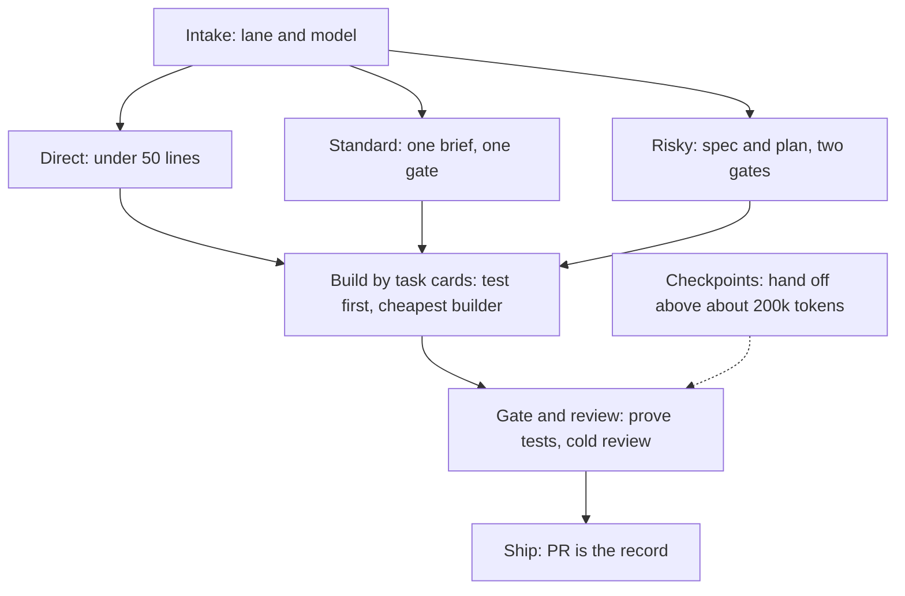
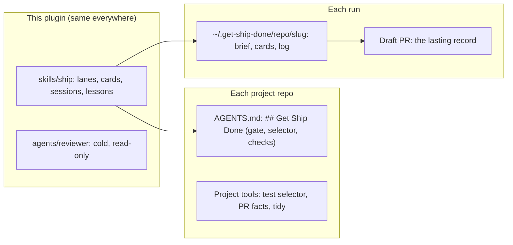

# Get Ship Done by Mubeen

A Claude Code plugin that takes one requirement to a draft pull request. It picks a lane by size and risk (Direct, Standard, Risky), writes one brief or a spec and plan ending in task cards, builds test-first, runs the project's gate, reviews cold where the lane calls for it, and ships. It hands work to fresh sessions at checkpoints so long runs stay cheap.

Overview with diagrams: https://mmubeenejaz.github.io/get-ship-done/

## How a run flows



## Where instructions live



## Install

```
claude plugin marketplace add mmubeenejaz/get-ship-done
claude plugin install get-ship-done@get-ship-done
```

Run it with `/get-ship-done:ship <requirement>`; resume with `/get-ship-done:ship resume <slug>`. Update with `claude plugin marketplace update get-ship-done`.

## Set up a project

Add a `## Get Ship Done` section to the project's `AGENTS.md` (or `CLAUDE.md`) naming:

- the gate (which CI run counts, how to start it, any backup and its preflight command);
- the test selector, if any (changed files in, tests to run out);
- the pre-check command, and any command a migration needs;
- the PR facts and housekeeping commands, if any;
- any text every subagent prompt must carry.

Without the section the skill finds the gate in the CI config and offers to add it.

## Run state

`~/.get-ship-done/<repo>/<slug>/` holds `brief.md` or `spec.md` and `plan.md`, and `log.md`. The draft PR body keeps the criteria and decisions, so the folder is disposable after merge.

## Changing it

Edit, bump `version` in `.claude-plugin/plugin.json`, push, and update the marketplace on each machine. Lessons in the skill grow from cold-review findings; a lesson that recurs twice belongs in the project as a lint rule or test.

## License

MIT
